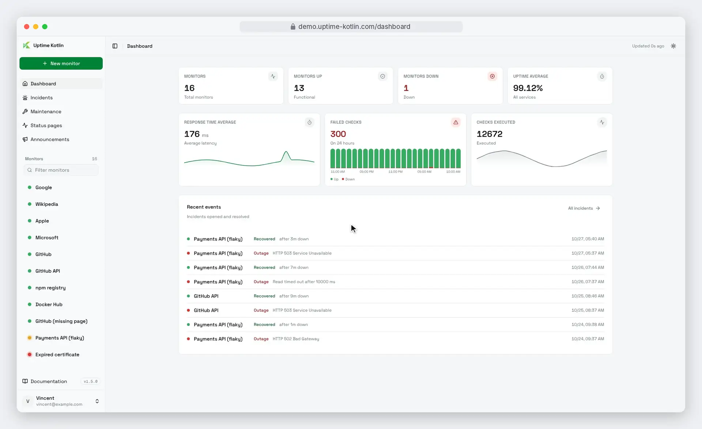
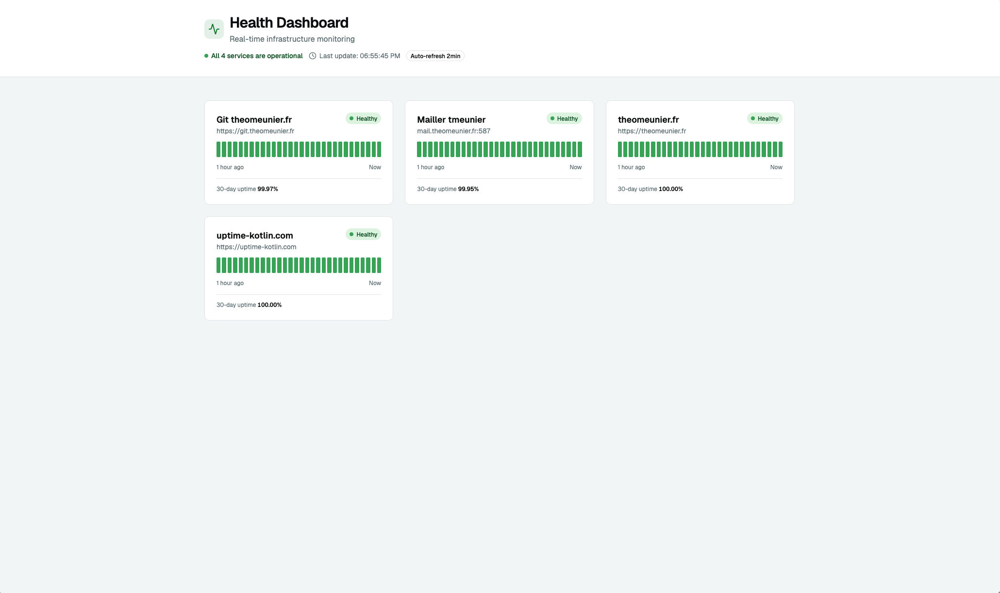
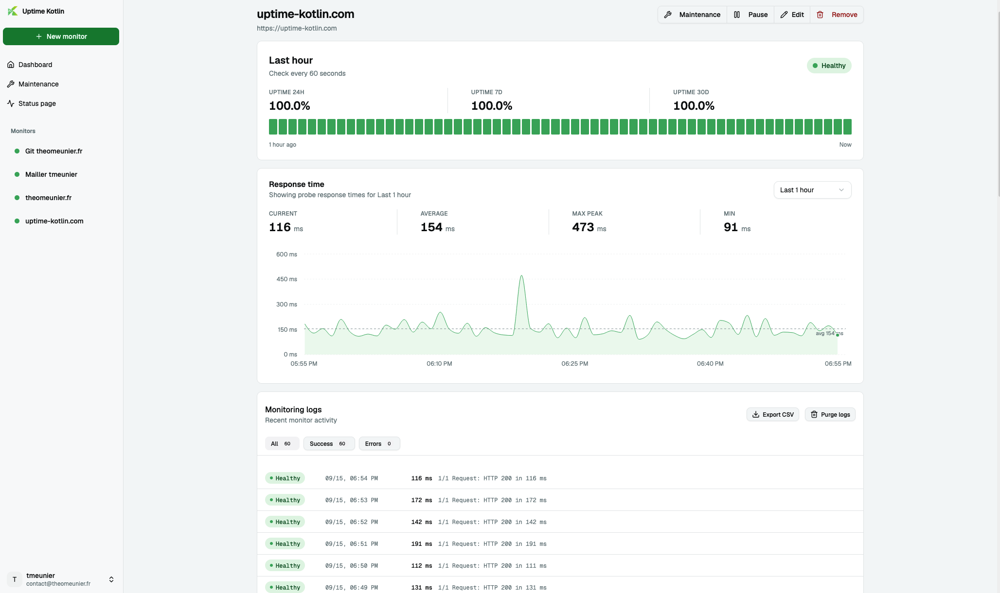

<div align="center">
<a href="https://github.com/TheoMeunier/uptime-kotlin">

</a>

<h2 align="center">Uptime Kotlin</h2>

<p align="center">
  Self-hosted uptime monitoring with public status pages.<br>
  One Docker image, <b>~50 MB of RAM</b>, amd64 and ARM64.
</p>

<p align="center">
  <a href="https://github.com/TheoMeunier/uptime-kotlin/releases">
    
  </a>
  <a href="LICENSE">
    
  </a>
  <a href="https://github.com/TheoMeunier/uptime-kotlin/actions/workflows/back-ci.yml">
    
  </a>
  <a href="https://github.com/TheoMeunier/uptime-kotlin/actions/workflows/app-ci.yml">
    
  </a>
  <a href="https://github.com/TheoMeunier/uptime-kotlin/stargazers">
    
  </a>
</p>

<p align="center">
  <a href="https://demo.uptime-kotlin.com"><b>Live demo</b></a>
  ·
  <a href="https://demo.uptime-kotlin.com/status/demo">Demo status page</a>
  ·
  <a href="#quick-start">Quick start</a>
  ·
  <a href="https://github.com/TheoMeunier/uptime-kotlin/issues/new?labels=bug&template=bug-report---.md">Report Bug</a>
  ·
  <a href="https://github.com/TheoMeunier/uptime-kotlin/issues/new?labels=enhancement&template=feature-request---.md">Request Feature</a>
</p>

<a href="https://demo.uptime-kotlin.com">
  
</a>
</div>

## Try it

The **[live demo](https://demo.uptime-kotlin.com)** is read-only: the login form is filled in for you, you can
open every page and form,
and nothing is saved. It monitors well-known public services, with a few failures on purpose (a 404, a flaky API, an
expired certificate) so you can see incidents and alerts.

Prefer the public side? Open the **[demo status page](https://demo.uptime-kotlin.com/status/demo)**.

## Features

- **Many protocols**: HTTP/HTTPS, TCP, DNS, ping, SMTP, PostgreSQL, MySQL/MariaDB, Microsoft SQL Server, Redis,
  Kafka and RabbitMQ
- **Real-time dashboard** with response times, uptime history and log export
- **Incidents** opened and closed automatically, with the downtime duration, and a CSV export for monthly reports
- **TLS certificate expiry** tracking
- **Notifications**: Email, Slack, Discord, Teams, Telegram, ntfy, Gotify, PagerDuty, Webhook and native browser notifications
  (Web Push), with optional reminders while a monitor stays down
- **Public status pages**, several per instance, in grid or list layout
- **Maintenance windows**, one-off or recurring, that mute alerts
- **Lightweight**: a native image that runs in **~50 MB of RAM**, on amd64 and ARM64
- **Cluster mode**: add workers to spread the checks, with no extra service (the job queue lives in PostgreSQL)
- **Prometheus metrics** and a ready-made Grafana dashboard to watch the monitor itself
- **Secure by default**: JWT authentication, stored secrets encrypted with your own key
- Interface in **English, French, German and Spanish**

<table>
  <tr>
    <td></td>
    <td></td>
  </tr>
  <tr>
    <td align="center">Public status page</td>
    <td align="center">Monitor details</td>
  </tr>
</table>

## Quick start

One image runs the web interface, the API and the checks. You only need it and PostgreSQL.

1. Create a `compose.yaml` file:

```yml
services:
  uptime-kotlin:
    image: ghcr.io/theomeunier/uptime-kotlin:latest
    container_name: uptime_kotlin
    restart: unless-stopped
    mem_limit: 512m
    ports:
      - "8080:8080"
    environment:
      TZ: Europe/Paris
      QUARKUS_DATASOURCE_USERNAME: uptime-kotlin
      QUARKUS_DATASOURCE_PASSWORD: change-me
      QUARKUS_DATASOURCE_JDBC_URL: jdbc:postgresql://postgres:5432/uptime-kotlin
      ENCRYPTION_MASTER_KEY: GENERATE_WITH_openssl_rand
      MP_JWT_VERIFY_ISSUER: https://issuer.uptime-kotlin.com
    depends_on:
      - postgres

  postgres:
    image: postgres:17.4-alpine
    container_name: uptime_kotlin_database
    restart: unless-stopped
    environment:
      POSTGRES_DB: uptime-kotlin
      POSTGRES_USER: uptime-kotlin
      POSTGRES_PASSWORD: change-me
      PGDATA: /var/lib/postgresql/data/pgdata
    volumes:
      - ./storage-db:/var/lib/postgresql/data
```

2. Replace `ENCRYPTION_MASTER_KEY` with the output of `openssl rand -base64 32` (the application refuses to start until
   you do), and both `change-me` passwords.
3. Run `docker compose up -d`.
4. Open `http://localhost:8080` and create your account.

> [!TIP]
> Keep the memory limit: the native heap is sized from the memory the container sees, ~50 MB with a limit, several
> hundred MB without.
>
> Behind a reverse proxy, forward every path to port `8080` and allow a 300 s read timeout for exports.

## Configuration

| Variable                                                                                        | Default    | Description                                                                                                                                                                                                  |
|-------------------------------------------------------------------------------------------------|------------|--------------------------------------------------------------------------------------------------------------------------------------------------------------------------------------------------------------|
| `ENCRYPTION_MASTER_KEY`                                                                         | (required) | At least 32 bytes. Encrypts the stored secrets and the JWT signing key. To change it, see [Rotate the master key](#rotate-the-master-key).                                                                   |
| `QUARKUS_DATASOURCE_USERNAME`<br>`QUARKUS_DATASOURCE_PASSWORD`<br>`QUARKUS_DATASOURCE_JDBC_URL` |            | PostgreSQL access.                                                                                                                                                                                           |
| `MP_JWT_VERIFY_ISSUER`                                                                          |            | Issuer of the JWT tokens.                                                                                                                                                                                    |
| `SCHEDULER_STRATEGY`                                                                            | `database` | `none` when workers run the checks (see [Cluster mode](#cluster-mode)).                                                                                                                                      |
| `SCHEDULER_WORKER_CONCURRENCY`                                                                  | `4`        | Checks run in parallel.                                                                                                                                                                                      |
| `MAINTENANCE_HORIZON_DAYS`<br>`MAINTENANCE_MAX_DURATION_HOURS`                                  | `90`, `24` | Maintenance windows. Same values on the application and the workers.                                                                                                                                         |
| `NOTIFICATIONS_DISPLAY_TIMEZONE`                                                                | `UTC`      | Zone of the dates in Slack, Teams, Telegram, ntfy, Gotify and e-mail notifications (IANA name, e.g. `Europe/Paris`). Same value on the application and the workers. Webhook payloads stay in UTC (ISO-8601). |
| `NOTIFICATIONS_WEB_PUSH_SUBJECT`                                                                | repo URL   | Contact given to the browser push services with each Web Push notification (`mailto:you@example.com` or an `https://` URL). Same value on the application and the workers. Browser notifications need the interface served over HTTPS (or `localhost`). |
| `NOTIFICATIONS_PAGERDUTY_EVENTS_URL`                                                            | PagerDuty  | PagerDuty Events API v2 endpoint (`https://events.pagerduty.com/v2/enqueue`). Accounts in the EU service region use `https://events.eu.pagerduty.com/v2/enqueue`. Same value on the application and the workers. |

<details>
<summary>Use your own JWT keys</summary>

Set both variables and mount the files: `MP_JWT_VERIFY_PUBLICKEY_LOCATION` (public key) and
`SMALLRYE_JWT_SIGN_KEY_LOCATION` (private key, PKCS#8).

</details>

### Cluster mode

Run the `uptime-kotlin` image with `SCHEDULER_STRATEGY: none` (it can be replicated behind a load balancer) and add
workers. The workers share a job queue stored in PostgreSQL, no extra service is needed.

```yaml
uptime-kotlin-worker:
  image: ghcr.io/theomeunier/uptime-kotlin/worker:latest
  container_name: uptime_kotlin_worker
  restart: unless-stopped
  environment:
    TZ: Europe/Paris
    SCHEDULER_STRATEGY: database
    SCHEDULER_WORKER_NAME: worker-primary
    SCHEDULER_WORKER_CONCURRENCY: "4"
    QUARKUS_DATASOURCE_USERNAME: uptime-kotlin
    QUARKUS_DATASOURCE_PASSWORD: change-me
    QUARKUS_DATASOURCE_JDBC_URL: jdbc:postgresql://postgres:5432/uptime-kotlin
    ENCRYPTION_MASTER_KEY: GENERATE_WITH_openssl_rand
  depends_on:
    - uptime-kotlin
```

`SCHEDULER_WORKER_NAME` must be unique per worker. Checks left by a stopped worker are picked up by the others after
30 seconds.

### Rotate the master key

1. Generate a new key (`openssl rand -base64 32`).
2. On the application **and every worker**: put the new key in `ENCRYPTION_MASTER_KEY` and the old one in
   `ENCRYPTION_PREVIOUS_MASTER_KEYS` (comma-separated if there are several).
3. Restart. On startup the application re-encrypts every stored secret with the new key and logs
   `Re-encrypted N stored secret(s)`. A warning lists the secrets no key could decrypt, to be re-entered.
4. Remove `ENCRYPTION_PREVIOUS_MASTER_KEYS` at the next deployment.

A lost key cannot be recovered: the secrets it encrypted must be re-entered, and the `jwt_signing_keys` row deleted
(this signs everyone out).

## Images

| Image                                      | Role                                     |
|--------------------------------------------|------------------------------------------|
| `ghcr.io/theomeunier/uptime-kotlin`        | Web interface, API and monitoring checks |
| `ghcr.io/theomeunier/uptime-kotlin/worker` | Monitoring checks only (cluster mode)    |

Both run on `linux/amd64` and `linux/arm64` (64-bit OS only).

### Build the images yourself

Native compilation needs about 8 GB of RAM for Docker.

```bash
docker build -f docker/all-in-one/Dockerfile.native -t uptime-kotlin:local .
docker build -f docker/worker/Dockerfile.native -t uptime-kotlin-worker:local .
```

## Built With

[Kotlin](https://kotlinlang.org/) · [Quarkus](https://quarkus.io/) (GraalVM native image) ·
[React](https://react.dev/) · [PostgreSQL](https://www.postgresql.org/) · [Docker](https://www.docker.com/)

## Contributing

Contributions are welcome! Read [CONTRIBUTING.md](CONTRIBUTING.md), then:

1. Fork the project
2. Create your feature branch (`git checkout -b feature/AmazingFeature`)
3. Commit your changes (`git commit -m 'Add some AmazingFeature'`)
4. Push to the branch (`git push origin feature/AmazingFeature`)
5. Open a pull request

You can also open an issue with the `enhancement` label. If you like the project, a ⭐ helps a lot!

## License

Distributed under the MIT License. See [LICENSE](LICENSE) for more information.
